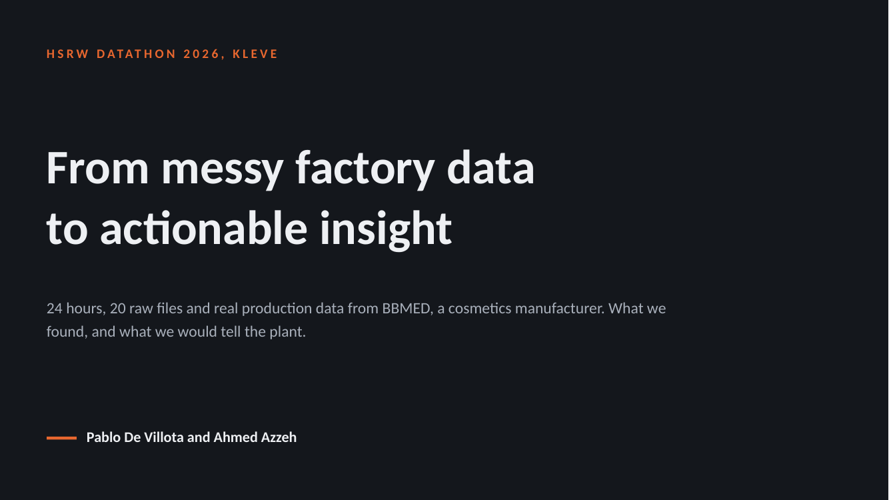
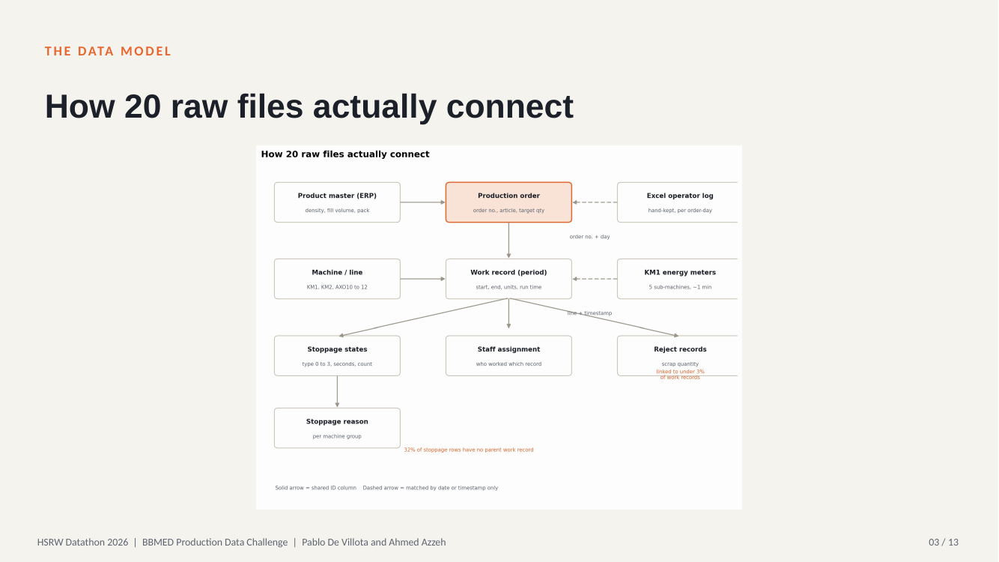
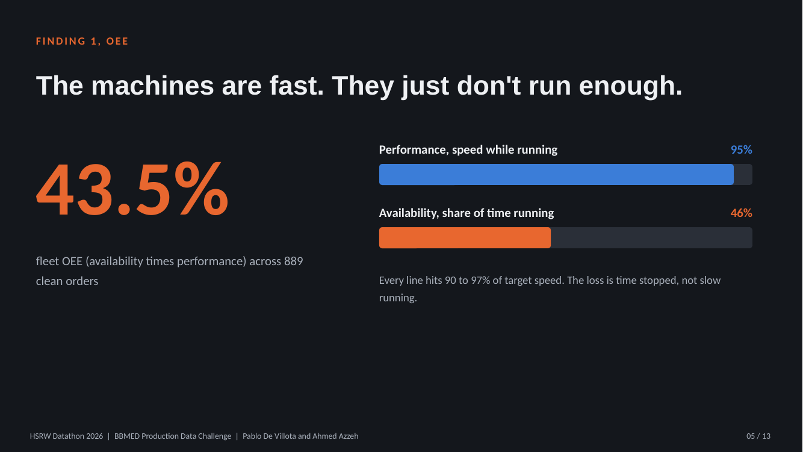
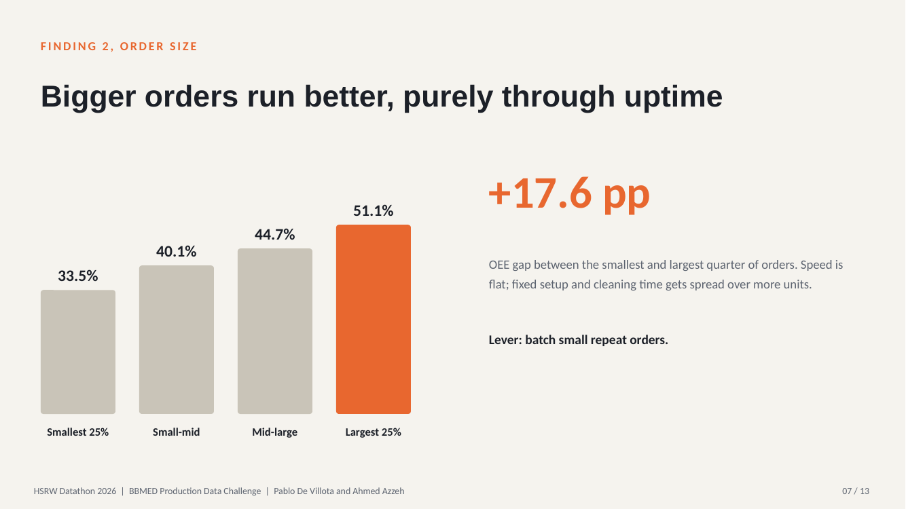
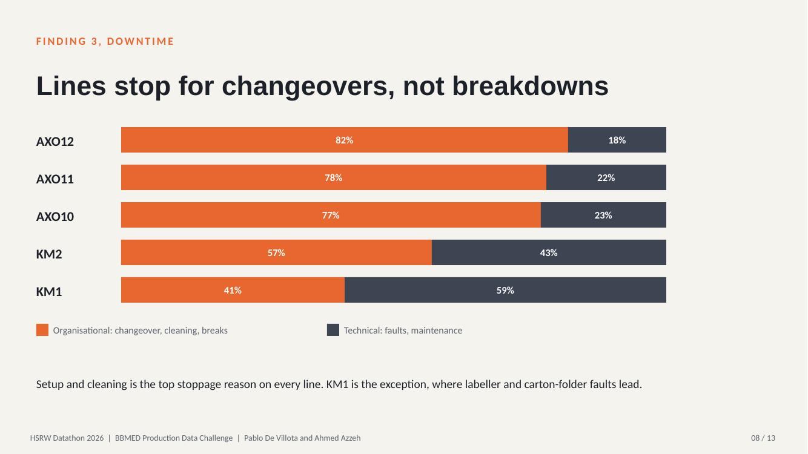
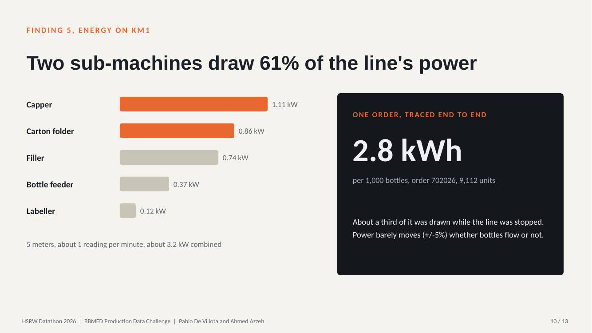

# BBMED Production Data Challenge, HSRW Datathon 2026

**Pablo De Villota and Ahmed Azzeh**, Hochschule Rhein-Waal, Kleve, 24 to 25 Sep 2026

A 24-hour datathon challenge using real, uncleaned production data from **BBMED**, a cosmetics manufacturer, covering five packaging lines (two bottle-filling, three tube-filling). The brief: understand production performance, stoppages, staffing and energy use, and recommend how the underlying data should be collected and structured going forward.

We didn't win, though the jury named it an extremely close decision. The analysis held up, and afterwards we went back and resolved two things we'd flagged as "can't be answered with this data" during the event itself (see [Findings 6](docs/findings.md#6-decoding-the-stoppage-table-post-event-follow-up)).



**Read more:**

- Full case study: [PDF](deliverables/BBMED_Datathon_Case_Study.pdf) · [Word](https://github.com/PKDV68/HSRW-Datathon/raw/refs/heads/main/deliverables/BBMED_Datathon_Case_Study.docx)
- Slide deck: [PDF](deliverables/BBMED_Datathon_Slides.pdf) · [PowerPoint](https://github.com/PKDV68/HSRW-Datathon/raw/refs/heads/main/deliverables/BBMED_Datathon_Slides.pptx)
- Condensed findings: [docs/findings.md](docs/findings.md)
- Data model: [docs/data_model.md](docs/data_model.md)

## Headline results

| | |
|---|---|
| Fleet OEE (availability times performance) | **43.5%** across 889 clean orders |
| Running speed while producing | about 95% of target on every line |
| OEE, largest vs smallest orders | **51.1% vs 33.5%** (+17.6 pp) |
| MES vs Excel agreement | 90% of 263 shared orders within +/-10% (median gap 0.65%) |
| KM1 energy intensity (one traced order) | about 2.8 kWh per 1,000 bottles |

## Why the data was hard

The plant runs three overlapping recording systems (MES, a hand-kept Excel log, and recently-installed energy meters) with no consistent ID scheme between them. The central blocker: `WorkRecordID` (MES's unit of work) has no link to `OrderNo` in most tables, so a stoppage or an energy reading can't be traced back to the order it happened during without first reconstructing that relationship. See [`docs/data_model.md`](docs/data_model.md).



## What we found

**The machines are fast, they just don't run enough.** Lines run at 90 to 97% of target speed, but availability is only 39 to 55%.



**Bigger orders run better, purely through uptime.** Setup and cleaning cost gets spread over more units.



**Lines stop for changeovers, not breakdowns.** KM1 is the exception, where labeller and carton-folder faults lead.



**Two sub-machines draw 61% of KM1's power.** Based on one fully traced order, so a first look rather than a final answer.



The full story, with the stoppage-table follow-up and recommendations, is in the [case study PDF](deliverables/BBMED_Datathon_Case_Study.pdf).

## Repo contents

```
deliverables/  Case study and slide deck (PDF, Word, PowerPoint)
notebooks/     Jupyter notebook reproducing the OEE, downtime, reconciliation
               and energy analysis, runnable end to end on synthetic data
src/           Reusable analysis functions + the synthetic sample-data generator
sample_data/   Synthetic data mirroring the real schema (generated, not real)
docs/          Data model, condensed findings and slide images
```

**BBMED's real data is not included in this repo.** Only synthetic sample data that mirrors its structure and known quirks, so the notebook is fully reproducible without needing the company's confidential data.

## Running it

```bash
git clone https://github.com/PKDV68/HSRW-Datathon.git
cd HSRW-Datathon
pip install -r requirements.txt
python src/make_sample_data.py        # generates sample_data/
jupyter notebook notebooks/01_oee_downtime_and_reconciliation.ipynb
```

## Tools

Excel for exploration; Python (pandas, matplotlib) for cleaning, cross-referencing, and the analysis in this repo.

## License

MIT, see [LICENSE](LICENSE). BBMED's real data, product names, and figures beyond what's summarised in `docs/findings.md` are not included and remain the company's own.
